# Greek-Inspired Agent Skills

Ten small skills help a coding agent work with discipline. Each skill does one job:

- Question a diagnosis before you fix it.
- Reduce a bug to its smallest example.
- Prove that work is done with a real test.
- Choose a script before a framework.

Each skill is one `SKILL.md` file. The file states when to use the skill, the steps to follow, the limits, and when to stop. The agent loads the file only when it picks the skill.

The names come from Greek thinkers. The names are memory hooks. These skills are modern adaptations. The Greek thinkers did not write about software. (The pictures are old busts from Wikimedia Commons.)

No skill is mandatory. A small text fix needs no skill. A payment change can use five skills.

## The ten patterns

<table>
<tr>
<td width="150" align="center" valign="top">
<br/>
<sub><a href="https://commons.wikimedia.org/wiki/File:Bust_of_Socrates.JPG">Socrates</a></sub>
</td>
<td valign="top">

**`socratic-debugging`** — Question the diagnosis before you fix the bug. Separate the facts from the guesses. List the causes that compete with your first idea. Then run the cheapest test that tells the causes apart.

**Example.** A token refresh fails. Do not fix the first idea. List four causes: token expiry, clock skew, two refreshes at the same time, and bad rotation. Read the timestamps. The timestamps show the true cause.

</td>
</tr>

<tr>
<td width="150" align="center" valign="top">
<br/>
<sub><a href="https://commons.wikimedia.org/wiki/File:Aristotle_bust.jpg">Aristotle</a></sub>
</td>
<td valign="top">

**`aristotelian-reasoning`** — Move from facts to a decision you can defend. Collect the facts. Classify the problem. Match each cause to a result you can see. Compare the options against your limits. Then verify.

**Example.** An endpoint is slow. Measure four costs on their own: database time, network delay, serialization, and algorithm work. Fix the largest cost. Run the same test again to confirm.

</td>
</tr>

<tr>
<td width="150" align="center" valign="top">
<br/>
<sub><a href="https://commons.wikimedia.org/wiki/File:Portrait_of_Euclid_Wellcome_L0019815.jpg">Euclid</a></sub>
</td>
<td valign="top">

**`euclidean-verification`** — Make the word "done" mean something. Turn the claim into properties you can see. Attach each property to a test, an inspection, or a measurement. Report what you tested and what you only think is true.

**Example.** You say a refactor keeps the same behavior. First list the inputs, the error cases, and the token lifecycle. Attach a test to each one. Report anything you did not test.

</td>
</tr>

<tr>
<td width="150" align="center" valign="top">
<br/>
<sub><a href="https://commons.wikimedia.org/wiki/File:Domenico-Fetti_Archimedes_1620.jpg">Archimedes</a></sub>
</td>
<td valign="top">

**`archimedean-decomposition`** — Divide a large task into parts with clear edges. Give each part its own test. Then do the step that people usually skip: join the parts and test the whole.

**Example.** You must improve fifty skills. List the skills. Agree on shared rules. Change the skills in small groups. Test each skill. Last, check the links, the names, and the overlaps across all skills.

</td>
</tr>

<tr>
<td width="150" align="center" valign="top">
<br/>
<sub><a href="https://commons.wikimedia.org/wiki/File:Plato_bust.png">Plato</a></sub>
</td>
<td valign="top">

**`platonic-quality-review`** — Replace vague words like "clean" with rules you can check. Write down what good means for this one artifact. Score the artifact against each rule. Fix the largest gaps first.

**Example.** For a teaching skill, good means correct, clear, step-by-step, and tested. Score a real skill against each rule. Do not score on feeling.

</td>
</tr>

<tr>
<td width="150" align="center" valign="top">
<br/>
<sub><a href="https://commons.wikimedia.org/wiki/File:Pythagoras_Bust_Vatican_Museum_(cropped).jpg">Pythagoras</a></sub>
</td>
<td valign="top">

**`pythagorean-invariant-checking`** — Name the properties that must stay true after a change. Make each property a test. Check every property after the change. Do not check only that the code compiles.

**Example.** You refactor a payment service. Keep three rules true: the totals are correct, no charge repeats, and the records agree. Test the normal path and the retry path.

</td>
</tr>

<tr>
<td width="150" align="center" valign="top">
<br/>
<sub><a href="https://commons.wikimedia.org/wiki/File:Bust_of_Heraclitus.jpg">Heraclitus</a></sub>
</td>
<td valign="top">

**`heraclitean-refinement`** — Make each try learn something. Change one thing for a clear reason. Measure the result against the start. If the result does not improve, change the idea — not the same code again.

**Example.** A test fails because of a race condition. Do not repeat the same change. Change the diagnosis. Add a test with two requests at the same time. Fix the rotation. Check again.

</td>
</tr>

<tr>
<td width="150" align="center" valign="top">
<br/>
<sub><a href="https://commons.wikimedia.org/wiki/File:Bust_of_Zeno_of_Citium-Ancient_Roman_busts_in_the_Neues_Museum.jpg">Zeno of Citium</a></sub>
</td>
<td valign="top">

**`stoic-control-filter`** — Sort the blockers into three groups: what you control, what you partly control, and what you cannot control here. Act on the first group. Reduce the second group. Report the third group clearly.

**Example.** A remote API is down. Run the local tests and the mocks that you can. Then say clearly that the live service is not verified.

</td>
</tr>

<tr>
<td width="150" align="center" valign="top">
<br/>
<sub><a href="https://commons.wikimedia.org/wiki/File:Epicurus_bust.jpg">Epicurus</a></sub>
</td>
<td valign="top">

**`epicurean-simplicity`** — Choose the simplest option that meets the real needs. Every new part must name the need that it serves.

**Example.** A one-time document change needs a script and a checklist. It does not need a multi-agent framework. Add more structure only when scale or safety needs it.

</td>
</tr>

<tr>
<td width="150" align="center" valign="top">
<br/>
<sub><a href="https://commons.wikimedia.org/wiki/File:Bust_of_Democritus.jpg">Democritus</a></sub>
</td>
<td valign="top">

**`democritean-reproduction`** — Reduce a messy bug to the smallest example that still fails. Keep only the condition that starts the bug. Now the cause and the fix are easy to see.

**Example.** A flaky test reduces to two token-refresh requests at the same time, with fixed state. This small example starts the race every time.

</td>
</tr>
</table>

### The coordinator

**`greek-engineering-workflow`** is not an eleventh skill. It puts the other ten skills in order for a full task. It also tells you which skills to skip. A small fix can use no skill. A risky refactor can use most skills.

## One pass, end to end

The examples above all use one bug on purpose. The diagram shows one disciplined pass through five skills. Most bugs need only two or three stages. The goal is not to run every stage. The goal is to not skip the stage that finds the bug.



1. **Socratic** — Do not trust the first cause. List the other causes. Include a concurrency bug.
2. **Democritean** — Reduce the bug to two refresh requests at the same time. Now the bug happens every time.
3. **Euclidean** — Write what the fix must prove. Decide what counts as evidence.
4. **Heraclitean** — Fix the rotation. Run the small test and the full tests. If the test still fails, change the diagnosis.
5. **Stoic** — If a service is down, report what passed and what is not verified.

## Where to start

Four skills do most of the work in a daily debug loop:

- **`socratic-debugging`** — challenge the first diagnosis.
- **`democritean-reproduction`** — find the smallest failing case.
- **`euclidean-verification`** — tie "done" to real tests.
- **`heraclitean-refinement`** — make each retry learn, and stop on a clear condition.

Add more skills when the task needs them:

- **`pythagorean-invariant-checking`** — for refactors.
- **`archimedean-decomposition`** — for large tasks.
- **`stoic-control-filter`** — when a network, a permission, or a service blocks the tests.

## Install

Add a skill with `npx`:

```bash
npx skill <name>
```

Install the starter set, one skill per line:

```bash
npx skill socratic-debugging
npx skill democritean-reproduction
npx skill euclidean-verification
npx skill heraclitean-refinement
```

The valid names are the ten patterns above plus `greek-engineering-workflow`.
